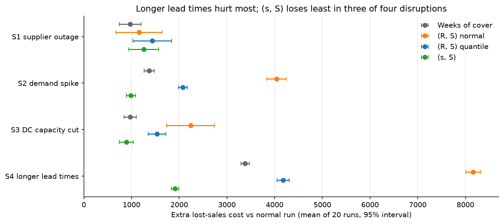
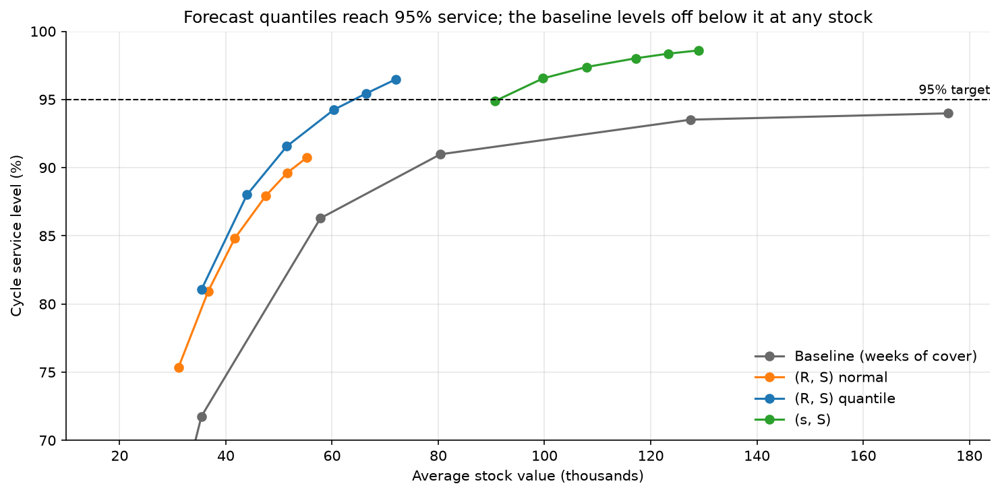

# Supply Chain Decision Platform

Forecast-driven inventory decisions for 821 Walmart food items, from daily demand forecasts to
weekly orders, tested in a day-by-day replay of 2016.

**Results so far**

- **Forecasting:** 23% lower error than seasonal naive on a held-out test window, with 95th
  percentile forecasts that cover 95.2% of days.
- **Inventory:** the same 90% service with **36% less stock** than a weeks-of-cover rule, and
  **27% lower total cost** with a forecast-based (s, S) policy.
- **Digital twin:** across five disruptions in a supplier → DC → store network, the (s, S) policy
  loses the least sales in three of them and is the cheapest in all five.

Built with Python, pandas, statsforecast, LightGBM (mlforecast), SciPy, SimPy and pytest, on the
[M5 dataset](https://www.kaggle.com/competitions/m5-forecasting-accuracy).

## Status

- [x] Phase 0 – Setup and data exploration
- [x] Phase 1 – Demand forecasting
- [x] Phase 2 – Inventory policies
- [x] Phase 3 – Digital twin
- [ ] Phase 4 – LLM agent

## Scope

Store CA_1, department FOODS_3: 823 items, daily sales from 2011-01-29 to 2016-05-22.
All assumptions are in [docs/assumptions.md](docs/assumptions.md).

## Phase 3 results: digital twin

The four Phase 2 policies run in a SimPy twin of a small network (supplier → distribution centre
→ store), through five disruption scenarios, 20 runs each with the same random draws for every
policy. Damage is measured against a normal run with the same draws.



| Policy | Total cost, normal | Extra lost sales: supplier outage (14 d) | Demand spike +50% (10 d) | DC capacity −50% (21 d) | Lead times ×2 (28 d) |
| --- | --- | --- | --- | --- | --- |
| Weeks of cover | 30,621 | **970** | 1,368 | 974 | 3,382 |
| (R, S) normal | 44,288 | 1,154 | 4,041 | 2,238 | 8,162 |
| (R, S) quantile | 31,659 | 1,438 | 2,075 | 1,536 | 4,178 |
| (s, S) | **23,889** | 1,258 | **989** | **893** | **1,913** |

Costs over 126 scored days, store + DC holding; extra lost sales = lost-sales cost above the
normal run. In the supplier outage the differences are within the 95% intervals.

**What I learned**

- The batches that make (s, S) cheap also make it robust: more stock on the shelf absorbs a shock
  the forecast did not see. The forecast policies are hit hardest by the unforecast demand spike.
- But (s, S) pushes problems upstream: the DC is out of stock on 17% of item-days and order
  variability rises from 0.17 to 0.27 between store and DC (bullwhip).
- Longer lead times are the worst disruption for every policy, and recovery takes 20–44 days.
- Extra DC stock for the top 20% of items is not worth it: it pays only above 9.3 two-week
  supplier outages a year, and it does nothing when the bottleneck is handling capacity.

Full analysis: [notebooks/04_digital_twin.ipynb](notebooks/04_digital_twin.ipynb)

## Phase 2 results: inventory policies

Four ordering policies were replayed day by day over 140 days (2016-01-04 to 2016-05-22), with
the same demand and the same random lead times (3–7 days), using only forecasts made before each day.



| Policy | Stock for 90% service | Stock for 95% service | Lowest total cost (at service) |
| --- | --- | --- | --- |
| Baseline: weeks of cover | 75,677 | not reachable (max 94.0%) | 23,737 (91.0%) |
| (R, S), textbook normal safety stock | 52,816 | not reachable (max 90.7%) | 30,702 (90.7%) |
| (R, S), calibrated forecast quantiles | **48,177** | **64,170** | 24,970 (96.5%) |
| (s, S), quantiles + economic order quantity | (always above 94%) | 91,313 | **17,430 (98.6%)** |

Stock is the average stock value; cost is holding + ordering + lost sales over 126 scored days.

**What I learned**

- Forecast quantiles beat the textbook safety stock: it promised 95% service and delivered 85%,
  because the forecast mean is biased low and past sales hide the demand lost to stockouts.
- A rule that copies past sales can get stuck: an item that sells nothing for a week is never
  reordered, so the baseline cannot reach 95% at any stock level.
- The forecast's gain is capital, not cost: holding is cheap (0.5% of price per week vs 30% for a
  lost sale), so the weekly forecast policy does not beat the best baseline on cost. Batching
  orders with (s, S) is what cuts the cost, by 72% fewer orders.
- The 95% service target was too low: with these costs, every forecast policy gets cheaper up to
  99.5% service.
- Not modelled: pack sizes, shelf space, supplier capacity and lead-time disruptions (Phase 3).

Full analysis: [notebooks/03_inventory.ipynb](notebooks/03_inventory.ipynb)

## Phase 1 results: demand forecasting

A hybrid forecast cuts error by **23% against seasonal naive** (RMSSE 0.752 vs 0.976) on a 28-day
test window no model saw during development, and its **95th percentile covers 95.2% of days**.

| Demand class | Items | Hybrid uses | RMSSE Hybrid | RMSSE seasonal naive | q95 coverage |
| --- | --- | --- | --- | --- | --- |
| Smooth | 173 | LightGBM | 0.762 | 0.980 | 95.4% |
| Erratic | 93 | LightGBM | 0.727 | 0.916 | 93.5% |
| Intermittent | 359 | AutoETS | 0.758 | 0.996 | 95.6% |
| Lumpy | 184 | AutoETS | 0.745 | 0.964 | 94.8% |
| **All** | **809** | | **0.752** | **0.976** | **95.2%** |

Test window 2016-04-25 to 2016-05-22; RMSSE below 1 means better than a one-day naive forecast.

**How it was built**

- Rolling-origin backtest: 4 validation windows of 28 days for every model choice; the final test
  window was used once, at the end.
- 12 models compared: benchmarks, AutoETS, AutoARIMA, Croston, TSB, ADIDA, IMAPA (statsforecast)
  and a global LightGBM with lag, price and calendar features (mlforecast).
- Days when an item was out of stock and Christmas Day are excluded from scoring.
- Prediction intervals are calibrated per model and demand class; raw conformal intervals covered
  only about 82% at the 95th percentile.

**What I learned**

- LightGBM gives the best point forecast for items that sell every day, but AutoETS gives the
  sharpest quantiles in every class, so the Hybrid combines LightGBM's point with AutoETS's interval.
- The gain over a 28-day moving average is modest (3%): daily item-level demand is mostly noise.
- On lumpy items LightGBM beat AutoETS on the test window, the opposite of validation; the
  validation choice was kept rather than re-picking on test data.

Full analysis: [notebooks/02_forecasting.ipynb](notebooks/02_forecasting.ipynb)

## Key findings from the data

- Once stockout days are removed, 66% of items have intermittent or lumpy demand and 21% sell
  steadily every day.
- Weekends sell ~55–60% more than midweek; SNAP days add ~12%.
- 84% of fast-moving items show long zero-sales runs, pointing to stockouts or unavailability.

Exploratory analysis: [notebooks/01_eda.ipynb](notebooks/01_eda.ipynb)

## How to run

1. Install [uv](https://docs.astral.sh/uv/) and run `uv sync`.
2. Download the [M5 data](https://www.kaggle.com/competitions/m5-forecasting-accuracy/data) into `data/raw/`.
3. Prepare the data:
```
   uv run python src/data/prepare.py
   uv run python -m src.forecasting.classes
```
4. Forecasting (ARIMA is the slow one, up to an hour on 2 cores):
```
   uv run python -m src.forecasting.run_backtest benchmarks
   uv run python -m src.forecasting.run_backtest stats
   uv run python -m src.forecasting.run_backtest arima
   uv run python -m src.forecasting.run_backtest lightgbm
   uv run python -m src.forecasting.calibrate
   uv run python -m src.forecasting.final_test
   uv run python -m src.forecasting.train_final
```
5. Inventory replay and sensitivity:
```
   uv run python -m src.inventory.run_replay
   uv run python -m src.inventory.sweep
```
6. Get a forecast in Python:
```python
from src.forecasting.forecast import forecast

forecast("FOODS_3_090", "CA_1", horizon=7)  # date, q50, q90, q95
```
7. Digital twin (about 30 minutes on 4 cores):
```
   uv run python -m src.simulation.run_twin
   uv run python -m src.simulation.mitigation
```
8. Run the tests with `uv run pytest`.